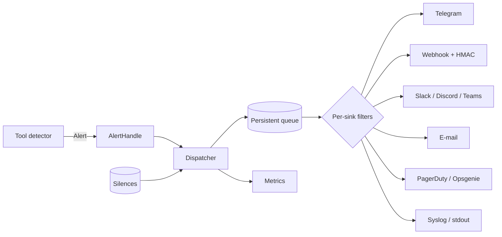

# Beacon Architecture

Beacon (`llcforge-beacon`) is the shared alerting and operations library of the LLCForge network tools. It is a library, not a service: each tool embeds it and owns the process.

## Design principles

- **Never block the caller.** Detection paths hand alerts to a bounded channel and continue; delivery happens on Beacon's own tasks.
- **Never lose an alert silently.** Undelivered alerts survive restarts in an on-disk queue; drops are counted and exported as metrics.
- **Secrets only from the environment.** Config names the environment variable; values never appear in config files, logs or the queue.
- **Same behaviour on Windows, macOS and Linux.** OS-specific code (SIGHUP, Unix syslog socket, Windows service) is `cfg`-gated with a working path on every platform.

## Data flow

## Modules

| Module | Responsibility |
|---|---|
| `alert` | `Alert` type and the versioned `llcforge.alert.v1` schema (`schema/alert.v1.json`). |
| `dispatcher` | Intake channel, dedup window, silence check, routing to sinks, delivery metrics. |
| `filter` | Per-sink selection by severity, tool, kind and resource glob. |
| `sink/*` | One module per channel; each builds its request, applies timeout, retry with backoff and jitter, and rate limiting. |
| `queue` | Append-only JSON-lines segments with fsync, torn-tail recovery, compaction and size bounds. |
| `silence` | Maintenance windows / silences store, `/v1/silences` API and CLI helpers. |
| `health` | `/healthz` and `/readyz` driven by named readiness checks. |
| `reload` | Reload trigger from SIGHUP (Unix), config file change (all OSes) and `POST /v1/reload`. |
| `service` | Windows service entry point and install helpers; points to systemd / launchd files on Unix. |
| `logging`, `metrics`, `auth`, `config`, `cli` | Uniform logging, Prometheus rendering, bearer-token checks, config types, shared subcommands. |

## How tools consume Beacon

`sync.py` copies the crate into `<tool>/crates/llcforge-beacon` and renders shared templates (CI, release, Docker, systemd, launchd, Windows service, Homebrew, Scoop, winget, Helm, Grafana, Prometheus, cargo-deny, Dependabot). Each tool stays buildable on its own; this repository is the single source of truth for the shared code.
